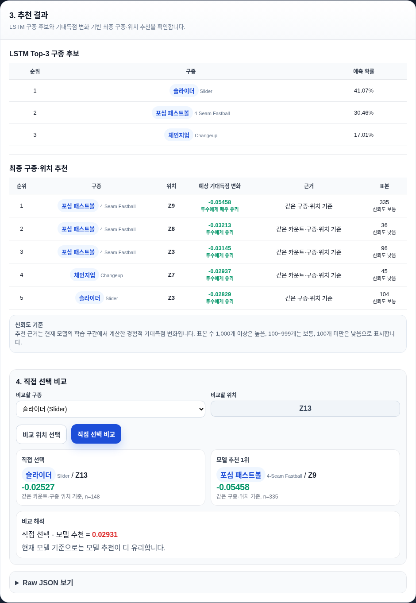

# MLB Statcast 기반 구종·투구 위치 추천 시스템

**2026년 1학기 · 세종대학교 딥러닝실습(Deep Learning Lab) 기말 개인 프로젝트**  
**수행 기간:** 2026.03–06  
**기술:** Python, PyTorch, pandas, scikit-learn, FastAPI, HTML/CSS/JavaScript

MLB Statcast의 투구 단위 데이터를 이용해 **다음 구종 후보를 예측**하고, 과거 기대득점 변화량(`delta_run_exp`)을 이용해 **구종과 투구 위치(zone) 조합을 경험적으로 순위화**한 웹 프로토타입입니다.

> **범위:** 학습·연구용 의사결정 지원 프로토타입입니다. 추천 순위가 실제 경기에서 최적의 볼배합이라는 의미는 아니며, 포수가 의도한 목표 위치를 예측하는 시스템도 아닙니다.

## 1. 핵심 결과

| 평가 대상 | Accuracy | Top-3 Accuracy | Macro F1 | Weighted F1 |
| --- | ---: | ---: | ---: | ---: |
| Pitcher + Count Majority (Baseline) | **40.60%** | 80.05% | 0.3329 | 0.3808 |
| **LSTM** | 38.96% | **83.53%** | **0.3972** | **0.3890** |
| Transformer Encoder | 37.22% | 82.93% | 0.3896 | 0.3691 |

- LSTM은 Top-1 정확도에서 단순 Baseline보다 낮았지만 **Top-3 정확도와 Macro F1에서 더 높았습니다.** 최종 시스템에서는 이를 단일 정답 결정기가 아닌 **후보 구종 생성기**로 사용했습니다.
- 별도의 `delta_run_exp` 경험적 추정 모듈은 테스트 데이터에서 **MAE 0.1314, RMSE 0.2408, R² 0.0088**을 기록했습니다. **설명력이 낮으므로 추천의 실제 경기 성과가 검증되었다고 해석할 수 없습니다.**
- 수치는 저장소의 [Baseline 결과](outputs/baseline_results.csv), [LSTM 결과](outputs/lstm_weighted_macro_result.csv), [Transformer 결과](outputs/transformer_weighted_macro_result.csv), [경험적 추정 평가](outputs/outcome_empirical_eval.csv)에서 확인할 수 있습니다.

### 한 투구의 추천 결과

2025년 6월 2일, 8회 무사 주자 없는 상황에서 볼카운트는 2볼 0스트라이크였다. LSTM이 뽑은 다음 구종 후보는 포심(FF), 스플리터(FS), 싱커(SI) 순이었다.

후보 구종과 투구 위치를 함께 평가한 결과 **싱커(SI)와 6번 존** 조합이 1위였다. 실제 투구는 9번 존에 들어온 슬라이더(SL)였고, 타자는 지켜봐서 스트라이크가 됐다. [해당 투구의 추천 결과 CSV](outputs/outcome_recommendation_sample.csv)

## 2. 문제 정의 및 시스템 구성

야구의 다음 투구 선택은 이전 투구 흐름, 볼카운트, 투수의 구종 구성, 주자·아웃 상황 등에 영향을 받습니다. 본 프로젝트는 이 문제를 **구종 후보 예측**과 **과거 관측 결과 기반 후보 순위화**라는 두 단계로 분리했습니다.

```text
현재 경기 상황 + 같은 타석 내 이전 투구(최대 5개)
                       |
                       v
                LSTM 구종 분류기
                       |
                예측 구종 Top-3
                       |
                       v
          추천 가능한 구종 후보 구성
      (LSTM 후보 + 투수 주 구종 보완 후보)
      (사용자가 구종을 지정하면 그 후보를 우선)
                       |
                       v
     후보 구종 × Statcast 실제 도착 zone
                       |
                       v
      delta_run_exp 경험적 평균 및 평활화
                       |
                       v
       낮은 점수 순으로 구종·zone 추천
                       |
                       v
              FastAPI + 웹 화면
```

**주의:** 최종 추천 후보는 항상 LSTM Top-3만으로 제한되지 않습니다. 웹 서비스는 투수의 주 구종을 보완 후보로 추가하며, 사용자가 후보 구종을 직접 지정한 경우 해당 후보를 우선합니다.

### 구현 기능

- `pybaseball.statcast`를 통한 정규시즌 투구 기록 수집과 전처리
- 이전 구종·zone 시퀀스(최대 5개)를 이용한 다음 구종 예측
- 6개 빈도 기반 Baseline 및 LSTM·Transformer Encoder 비교
- 조건별 표본 수 기준과 평활화를 적용한 `delta_run_exp` 경험적 랭킹
- 경기 상황 입력, 구종 후보 제한, 구종·zone 시각화, 사용자 선택 비교 기능을 갖춘 로컬 웹 데모

## 3. 데이터 및 실험 설계

| 항목 | 내용 |
| --- | --- |
| 데이터 출처 | MLB Statcast (수집 도구: `pybaseball`) |
| 수집 기간 | 2023-03-01 – 2025-09-27 |
| 현재 수집 스크립트의 경기 유형 | 정규시즌(`game_type == "R"`) |
| 정규시즌 재수집 | 7,274경기, 2,140,651건 |
| 구종 예측 전처리 후 | 2,132,356건 |
| 구종 예측 시퀀스 | 1,584,123건 |
| 기대득점 랭킹용 시퀀스 | 1,584,123건 |

이 표는 현재 정규시즌 필터로 다시 수집한 결과입니다. 제출 당시 기록의 수집 건수는 약 2,286,376건이며, 최초 결과를 올린 커밋의 수집기는 정규시즌 외 경기 유형도 포함했습니다. 원본 데이터는 별도 수집이 필요합니다. [전체 기간 재현과 공개 결과 비교](docs/MAINTENANCE.md#20232025-전체-기간-재현)

### 구종 예측 입력

- **이전 투구:** 같은 타석에서 현재 투구 직전까지의 구종 및 Statcast zone, 최대 5개(부족한 길이는 패딩)
- **현재 상황:** 볼·스트라이크·아웃카운트, 이닝, 1·2·3루 주자 유무
- **선수 특성:** 투수 ID, 투수 투구 손, 타자 좌우
- **정답:** 실제 다음 투구의 `pitch_type` (희귀 구종은 `OTHER`로 통합)

같은 타석의 **첫 투구는 이전 투구 이력이 없으므로 학습 시퀀스에서 제외**합니다. `batter`는 생성 데이터와 API 요청 요약에 포함되는 타자 ID입니다. 구종 예측에 사용하는 타자 입력은 타석 방향(`stand`)이며, 랭커는 아래의 투수·볼카운트·구종·zone 통계를 사용합니다.

### 데이터 분할과 평가

- **LSTM·Transformer:** 날짜·경기·타석·투구 순으로 정렬 후 **학습 70% / 검증 10% / 테스트 20%**. 검증 Macro F1 기준으로 모델 선택
- **Baseline:** 같은 정렬 순서의 **앞 80% 학습 / 뒤 20% 테스트**
- **경험적 기대득점 추정:** 별도 전처리된 데이터의 **앞 80% 학습 / 뒤 20% 테스트**
- 두 시퀀스 데이터셋은 결측 필터링 등이 달라 완전히 같은 행 집합이 아닙니다. 실험 결과를 비교할 때 이를 고려해야 합니다.

## 4. 모델과 추천 로직

### 4.1 다음 구종 예측

- **Baseline:** Global Majority, Count/Base Majority, Pitcher Majority, Pitcher + Count Majority, Previous Pitch Markov, Previous Pitch + Count
- **LSTM (Long Short-Term Memory):** 구종·zone 임베딩을 순차 처리하고 수치형·범주형 상황 특성을 결합하는 다중 클래스 분류 모델
- **Transformer Encoder:** 동일한 문제에 대한 비교 모델
- **학습 설정:** 시드 42, 최대 8 epoch, 배치 512, 학습률 0.001, 클래스 가중 Cross Entropy Loss, 검증 Macro F1에 따른 최적 체크포인트 선택

학습 설정과 네트워크 구현은 [`src/train_lstm.py`](src/train_lstm.py), [`src/train_transformer.py`](src/train_transformer.py)에서 확인할 수 있습니다.

### 4.2 기대득점 변화량 기반 경험적 랭킹

추천 점수는 `delta_run_exp`의 과거 관측 평균을 사용합니다. 점수가 낮을수록 **과거 표본에서 공격팀 기대득점 변화가 낮게 나타난 조합**입니다.

세부 조건의 표본이 부족하면 다음 순서로 일반적인 통계로 대체합니다.

| 우선순위 | 통계 그룹 | 최소 표본 수 |
| --- | --- | ---: |
| 1 | 투수 + 볼카운트 + 구종 + zone | 5 |
| 2 | 투수 + 구종 + zone | 10 |
| 3 | 볼카운트 + 구종 + zone | 20 |
| 4 | 구종 + zone | 30 |
| 5 | 구종 | 50 |
| 6 | 전체 평균 | 앞선 조건을 모두 충족하지 못한 경우 |

통계에는 전역 평균을 이용한 평활화(`alpha = 50`)를 적용합니다. `source`와 `source_count`는 사용된 통계 그룹과 그 표본 수를 나타냅니다. 서빙에서 전체 평균을 사용하면 `source_count`는 `0`으로 반환되며, 화면에는 `미제공`으로 표시됩니다. 직접 비교의 `selected_minus_best`는 **직접 선택의 모델 점수에서 추천 1위의 모델 점수를 뺀 값**입니다.

구현: [`src/outcome_empirical_recommender.py`](src/outcome_empirical_recommender.py), [`src/export_serving_artifacts.py`](src/export_serving_artifacts.py).

## 5. 웹 데모

FastAPI 백엔드와 HTML·CSS·JavaScript로 구현한 **로컬 실행형** 데모입니다. 현재 저장소에는 공개 배포 URL이나 즉시 실행 가능한 학습 모델 파일이 없습니다.

**지원 기능**

1. 고정 예시 투수의 투수·타자 좌우, 볼카운트, 아웃카운트, 주자·이닝 상황 입력
2. 이전 투구 구종 및 위치 입력, 구종 후보 수동 제한
3. LSTM 구종 예측 Top-3와 후보 확률 확인
4. 추천 구종·zone 및 근거 통계 조회
5. 선택한 구종·zone 점수와 최상위 추천 점수 비교

아래는 [2주치 Statcast 데모](#2주치-statcast로-데모-실행)에서 생성한 추천·비교 화면입니다.



| 경로 | 기능 |
| --- | --- |
| `GET /` | 웹 인터페이스 |
| `GET /health` | 추천 모델 준비 상태. 파일 누락 시 `503`과 누락 파일명 반환 |
| `GET /live` | 서버 프로세스 응답 확인 |
| `GET /meta` | 지원 구종, zone 등 메타데이터 |
| `POST /recommend` | 후보 생성 및 경험적 랭킹 |
| `POST /compare` | 사용자가 선택한 조합과 추천 점수 비교 |
| `GET /docs` | FastAPI 자동 API 문서 |

`/recommend`와 `/compare`에서 `prev_pitch_types`와 `prev_zones`의 같은 인덱스는 같은 투구를 가리킵니다. 오래된 투구부터 입력하고, 이력이 없으면 두 배열을 생략하거나 빈 배열로 보냅니다. 배열 길이가 다르면 HTTP `422`와 `pitch_history_length_mismatch`를 반환합니다.

`/compare`에 보낸 구종 또는 위치가 유효하지 않거나 모델의 지원 범위를 벗어나면 HTTP `422`와 기존의 `error` 응답 본문을 반환합니다. 앞서 HTTP `200`에서 이 본문을 읽던 호출자는 `422`에서도 `error`를 읽어야 합니다. 응답에는 문제가 된 입력값과, 지원 범위 밖인 경우 `/meta`에서 확인할 수 있는 지원 구종 또는 위치 목록이 포함됩니다. 필드 누락이나 이력 배열 길이 불일치 같은 요청 검증 오류는 HTTP `422`와 `detail` 배열을 반환합니다.

## 6. 설치 및 실행

**전제:** Python 3.12 기준으로 작성되었으며, 저장소 루트에서 명령어를 실행합니다. 데이터 수집·학습은 대용량 연산과 시간이 필요합니다.

```bash
python3.12 -m venv .venv
source .venv/bin/activate
```

가상환경을 활성화한 뒤 프로젝트 의존성을 설치합니다.

```bash
python -m pip install -r requirements.txt
```

위 예시는 Bash 기준입니다. Linux x86-64에서 CPU용 PyTorch로 설치하는 경우 의존성 설치 단계에서 아래 명령을 사용합니다.

```bash
torch_version=$(sed -n 's/^torch==//p' requirements.txt)
python -m pip install --index-url https://download.pytorch.org/whl/cpu "torch==${torch_version}+cpu"
python -m pip install -r requirements.txt
```

### 실험 경로 선택

`PITCH_RUN_DIR`에 실행 경로를 지정하면 수집, 학습, 평가와 웹 서버가 그 아래의 `data/`, `models/`, `results/`를 함께 사용합니다. 아래 예시는 저장소 루트에서 실행하며, 같은 실험의 명령과 서버에 동일한 값을 사용합니다. 경로를 생략하면 스크립트는 현재 작업 디렉터리, 웹 서버는 저장소 루트에서 데이터 또는 모델 파일을 찾습니다.

새 실험 결과는 `results/`에 저장됩니다. `outputs/`는 공개 실험 요약을 보관합니다. 오프라인 랭커는 `results/lstm_weighted_macro_predictions.csv`를 우선 읽고, 파일이 없으면 같은 실행 경로의 기존 `outputs/lstm_weighted_macro_predictions.csv`를 읽습니다.

### 2주치 Statcast로 데모 실행

아래 명령은 2025년 6월 1~14일 정규시즌 투구를 Baseball Savant에서 받아 LSTM과 경험적 랭커의 서빙 파일을 생성합니다. 데이터 수집에 인터넷 연결이 필요합니다. 저장소 루트에서 가상환경을 활성화하고 실행합니다.

```bash
export PITCH_RUN_DIR="$PWD/runs/statcast-demo-2025-06"
export PYBASEBALL_CACHE="$PITCH_RUN_DIR/.pybaseball-cache"

python -u src/download_statcast.py --start-date 2025-06-01 --end-date 2025-06-14
python -u src/preprocess.py
python -u src/make_sequence.py
python -u src/train_lstm.py
python -u src/make_outcome_sequence.py
python -u src/export_serving_artifacts.py
python -m uvicorn web.backend.app:app --host 127.0.0.1 --port 8000
```

`http://127.0.0.1:8000`에서 **추천 받기**와 **직접 선택 비교**를 실행할 수 있습니다. 이 예시는 웹 데모를 확인하기 위한 2주 표본으로, 고정 예시 투수 ID는 해당 표본에서 미등록 투수로 처리됩니다. 아래 전체 실험 명령에서 날짜 옵션을 생략하면 기존 2023~2025 수집 범위를 사용합니다.

### 처음부터 재현하는 경우

```bash
export PITCH_RUN_DIR="$PWD/runs/statcast"

# 1. 데이터 수집 및 확인
python -u src/download_statcast.py
python -u src/check_csv.py
python -u src/check_data_summary.py

# 2. 구종 예측 데이터 및 모델
python -u src/preprocess.py
python -u src/make_sequence.py
python -u src/baseline.py
python -u src/train_lstm.py
python -u src/train_transformer.py

# 3. 경험적 랭킹 및 웹 서빙 파일
python -u src/make_outcome_sequence.py
python -u src/outcome_empirical_recommender.py
python -u src/export_serving_artifacts.py
```

- `train_transformer.py`는 **비교 실험용**이므로 LSTM 기반 웹 데모 구동에 필수는 아닙니다.
- `outcome_empirical_recommender.py`는 평가 결과 및 추천 결과를 생성합니다. **웹 서빙 파일 생성에는 `make_outcome_sequence.py`, `train_lstm.py` 실행 결과와 `export_serving_artifacts.py`가 필수**입니다.
- 랭커 평가에 `--diagnostics`를 추가하면 `results/outcome_empirical_diagnostics.json`을 생성합니다. 같은 테스트 투구의 관측 `delta_run_exp`를 기준으로 기존 랭커, 적합 구간 전체 평균, 구종·위치별 단순 평균의 MAE·RMSE·R²를 비교합니다. 적합 구간에 없는 조합은 전체 평균을 사용하고 해당 건수를 기록합니다. LSTM Top-3와 구종 빈도를 함께 쓰는 기존 후보 규칙과 빈도만 쓰는 규칙에 대해, 순위를 매기기 전 실제 구종·위치가 후보에 포함된 비율과 평균 후보 조합 수를 기록합니다. LSTM Top-3 결합 건수도 이 파일에서 확인할 수 있습니다. [2주 표본 결과와 해석](docs/MAINTENANCE.md#2주-표본-기준선-비교)
- 진단 JSON의 `result_sha256`으로 같은 실행의 평가·추천 CSV를 확인할 수 있습니다. 기본 평가를 다시 실행하면 이전 진단 파일을 제거합니다.
- 자동 통합 테스트는 합성 Statcast 응답으로 실행 경로, 학습, 서빙 파일 생성과 API 응답을 확인합니다. [테스트 실행 방법](tests/README.md)

### 경기 단위 시간 분할 실험

새 `PITCH_RUN_DIR`에 `data/raw/savant_data.csv`와 `data/raw/savant_data_with_outcome.csv`를 준비합니다. 같은 경기의 투구와 같은 날짜 경기가 서로 다른 분할에 들어가지 않도록, 경기 수 기준 70/10/20에 가까운 날짜 경계를 선택합니다. 날짜가 최소 3개 필요하며 생성한 분할 CSV를 실험 입력과 함께 보관합니다.

```bash
export PITCH_RUN_DIR="$PWD/runs/statcast-game-split"
python -u src/game_split.py
export PITCH_GAME_SPLIT="$PITCH_RUN_DIR/data/processed/game_split.csv"
```

이후 같은 터미널에서 위 파이프라인의 `preprocess.py`부터 실행합니다. 분류 시퀀스의 희귀 구종 기준과 LSTM·Transformer는 `train`을 사용하고, 두 모델은 `validation`으로 체크포인트를 고릅니다. 다수결과 랭커는 `train`과 `validation`을 합쳐 적합합니다. 평가는 모두 같은 `test` 경기 목록을 사용하며, 각 파이프라인의 기존 필터에 따라 투구 수는 달라질 수 있습니다. `PITCH_GAME_SPLIT`을 생략하면 기존 투구 행 단위 분할을 사용합니다.

LSTM과 Transformer는 정답 구종이 학습 클래스에 없는 행을 검증·테스트 지표에서 제외합니다. LSTM은 추천 평가를 위해 테스트 전체의 예측을 저장하며, 제외된 행이 있으면 `included_in_test_metrics`로 지표 계산 대상을 표시합니다. 날짜 분할에서 랭커는 동일한 분할표의 SHA-256이 있는 LSTM 예측 파일만 결합합니다. 기존 날짜 분할 예측 파일은 같은 분할표로 다시 생성하세요.

날짜 분할에서 `make_outcome_sequence.py`는 랭커 적합에 쓰는 `train`·`validation` 경기만 희귀 구종 집계에 포함합니다. 그 집계에서 500건 미만이거나 등장하지 않은 구종과 기존 강제 통합 구종은 `OTHER`가 됩니다. 기존 명령의 `--train-only-rare-pitches`도 같은 규칙을 사용합니다.

랭커 CSV의 결측 투구 이력을 비교하려면 같은 설정과 별도 실행 경로를 쓰고 `make_outcome_sequence.py`에 `--keep-unlabeled-history`를 추가합니다. 구종을 아는 투구는 위치나 결과값이 빠져도 이력에 남고, 위치가 비어 있으면 `ZUNK`로 기록됩니다. 이 옵션은 랭커 CSV의 이력과 평가 행 선택에 적용됩니다. 이력이 구종 예측에 미치는 효과는 같은 테스트 투구에서 LSTM 입력 이력을 바꿔 별도로 평가합니다.

### 웹 서버 실행

새 LSTM 체크포인트는 희귀 구종 이력의 `OTHER` 매핑을 함께 저장합니다. 서빙에도 이 매핑을 적용하려면 LSTM을 학습한 뒤 다시 내보냅니다.

서버는 시작할 때 `models/serving-current`가 가리키는 `models/serving/<세대>/`의 LSTM과 랭커를 함께 로드합니다. 내보내기는 두 파일을 준비한 뒤 현재 세대를 교체합니다. 기존 실행 경로에 `serving-current`가 없으면 `models/` 바로 아래의 기존 파일 두 개를 읽습니다. 새 터미널에서는 수집·학습에 사용한 실행 경로를 다시 지정하세요.

```bash
export PITCH_RUN_DIR="$PWD/runs/statcast"
uvicorn web.backend.app:app --reload --host 127.0.0.1 --port 8000
```

접속: [http://127.0.0.1:8000](http://127.0.0.1:8000) · [API 문서](http://127.0.0.1:8000/docs)

서빙 파일이 없어도 웹 화면, `/docs`, `/live`를 사용할 수 있습니다. 이 상태에서 `/health`는 `503`과 누락 파일명을 반환하고, `/meta`·`/recommend`·`/compare`도 `503`을 반환합니다. 서빙 파일을 생성하거나 별도로 확보한 뒤 서버를 재시작하면 추천·비교를 사용할 수 있습니다. 두 파일이 존재하지만 로드할 수 없는 경우는 서버 시작 오류로 보고합니다.

## 7. 저장소 구성

아래는 **현재 GitHub에 실제로 추적되는 파일** 중심의 구조입니다. 모델·대용량 데이터는 `.gitignore`에 의해 제외됩니다.

```text
.
├── README.md
├── requirements.txt
├── .gitignore
├── docs/
│   ├── final_report.pdf
│   ├── final_presentation.pdf
│   ├── images/statcast-demo.png
│   └── MAINTENANCE.md
├── outputs/
│   ├── baseline_results.csv
│   ├── lstm_weighted_macro_result.csv
│   ├── transformer_weighted_macro_result.csv
│   ├── outcome_empirical_eval.csv
│   └── outcome_recommendation_sample.csv
├── src/
│   ├── download_statcast.py
│   ├── check_csv.py
│   ├── check_data_summary.py
│   ├── preprocess.py
│   ├── make_sequence.py
│   ├── baseline.py
│   ├── train_lstm.py
│   ├── train_transformer.py
│   ├── make_outcome_sequence.py
│   ├── outcome_empirical_recommender.py
│   └── export_serving_artifacts.py
└── web/
    ├── backend/
    │   ├── app.py
    │   ├── frontend.py
    │   ├── schemas.py
    │   ├── service.py
    │   └── pitch_inputs.py
    └── frontend/
        ├── index.html
        └── assets/
            ├── styles.css
            └── app.js
```

**실행 경로 기준으로 로컬에 생성되는 주요 파일**

| 경로 | 용도 |
| --- | --- |
| `data/raw/`, `data/processed/` | 원본 CSV, 전처리 및 시퀀스 데이터 |
| `models/lstm_weighted_macro_best.pt` | 학습된 LSTM 체크포인트 |
| `models/serving/<세대>/lstm_serving_artifact.pt` | 웹 서빙용 LSTM artifact |
| `models/serving/<세대>/outcome_ranker_artifact.pkl` | 웹 서빙용 경험적 통계 |
| `results/lstm_weighted_macro_predictions.csv` | 테스트 구간 LSTM 예측 결과 |
| `results/outcome_empirical_recommendations.csv` | 테스트 구간 추천 상세 결과 |

[추천 결과 샘플 CSV](outputs/outcome_recommendation_sample.csv)는 저장소에 포함되어 있습니다.  
[최종 보고서 PDF](docs/final_report.pdf) · [최종 발표 자료 PDF](docs/final_presentation.pdf)

## 8. 한계와 해석 시 주의사항

1. **추천의 인과적 타당성 미검증:** `delta_run_exp`는 실제 선택된 투구에서 관측된 값입니다. 다른 구종이나 위치를 선택했을 때의 반사실적 성과를 보장하지 않습니다.
2. **기대득점 추정 성능 한계:** 테스트 R²가 0.0088로 매우 낮습니다. 추천 순위와 실제 실점 감소를 동일시해서는 안 됩니다.
3. **위치의 의미:** Statcast zone은 투구가 도착한 위치이며, 포수가 의도한 목표 위치와 다를 수 있습니다.
4. **상황 정보의 제약:** 점수 차, 투구 수, 피로도, 타자 개인별 약점 등은 현재 서빙 추천 규칙에 충분히 반영되지 않았습니다.
5. **평가 일치성:** 구종 예측용 데이터와 경험적 랭킹용 데이터는 필터링이 달라 동일한 테스트 표본이라고 단정할 수 없습니다.
6. **실행 재현성:** 웹 화면과 API 문서는 모델 파일 없이 열 수 있습니다. 추천·비교에는 서빙 파일이 필요합니다. 자동 테스트는 합성 데이터로 실행하고, 공개 성능 수치 재현에는 해당 기간의 Statcast 데이터가 필요합니다.

## 9. 향후 정비

우선순위는 **재현 가능성 확보 → 실험 타당성 검토 → 코드 테스트 → 데모·문서 개선**입니다.

구체적인 확인 사항과 개선 목록은 [프로젝트 정비 점검표](docs/MAINTENANCE.md)에 정리했습니다. 기존 기능과 실험 산출물을 보존하면서 단계적으로 개선할 계획입니다.
